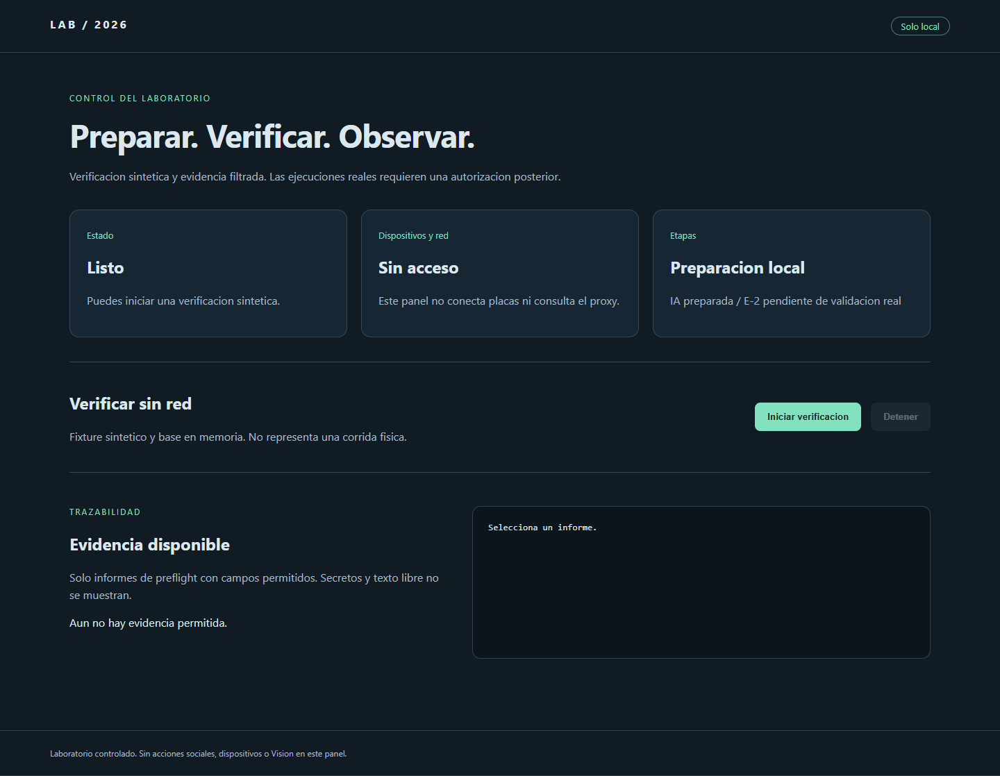
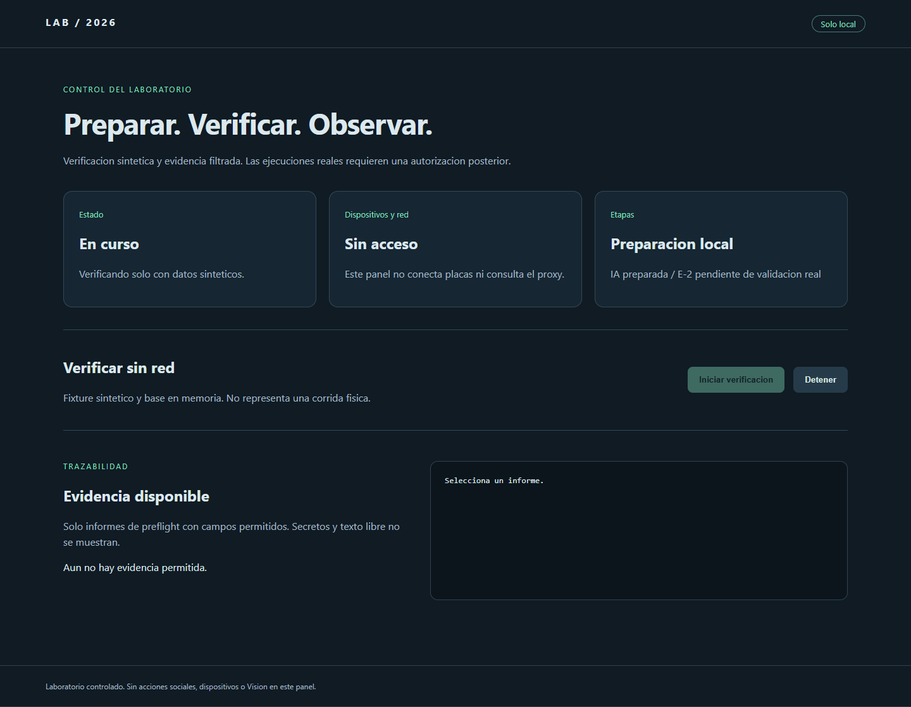
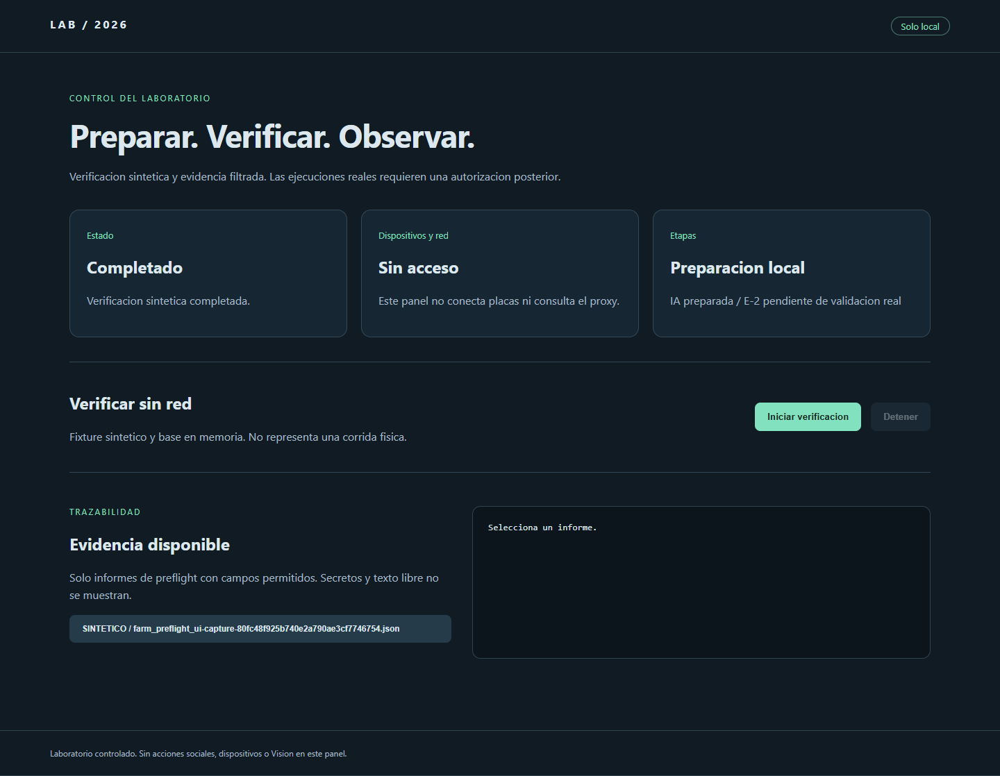
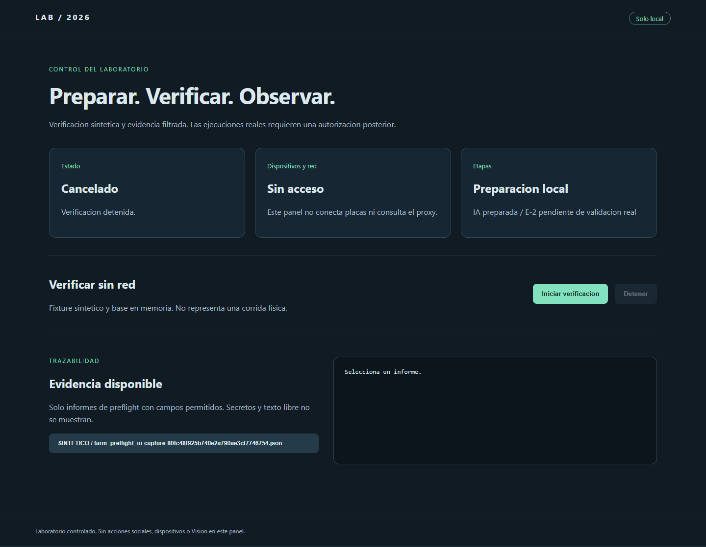
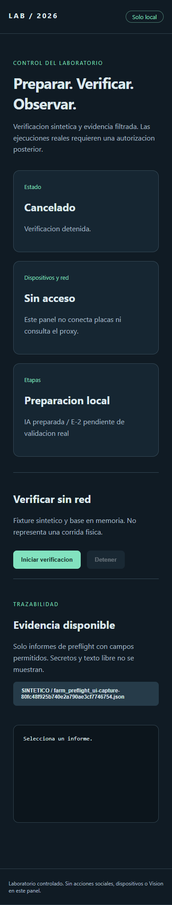

# Contrato de la UI del laboratorio

## Alcance

Esqueleto para E-5 del plan. Panel local sobre el flujo existente.

## Panel local preparado (2026-11-08)

Ejecutar desde el framework: `.venv\Scripts\python.exe -m ui.lab_api`.
Abrir `http://127.0.0.1:8765`. FastAPI y uvicorn quedan declarados en
requirements.txt. No se consulta proxy, Panda, ADB o OpenAI al abrir el panel.
Esto prepara E-5 y no declara completas las validaciones fisicas E-2..E-4.

GET /api/status expone estado, etapas, ultimo preflight filtrado y ultimo
check local. last_run permanece null: el panel no acredita corrida fisica.
GET /api/evidence lista hasta 100 informes farm_preflight_*.json permitidos.
GET /api/evidence/{id} sirve solo identificador, decision, synthetic y
veredictos/counters agregados. Descarta texto libre, secretos, rutas arbitrarias,
symlinks y archivos de mas de 1 MB. No es un visor general de runs/.
POST /api/actions/verify ejecuta el fixture sintetico con SQLite en memoria.
POST /api/actions/stop cancela cooperativamente y conserva el estado final.
Acciones reales, pausa y Vision devuelven 403. No hay boton que las active.
El servidor exige host loopback, origen coincidente y cabecera X-Lab-Action
para acciones. No debe publicarse mediante tuneles o reverse proxies.

El frontend refleja estados en tarjetas y permite seleccionar evidencia.
La UI se comprobo con TestClient y Chromium headless en loopback, con
almacenamiento temporal y fixture sintetico (no datos de dispositivos).
Capturas reales del navegador, autorizadas para esta entrega:

E-1/E-2: iniciar y detener verificacion sintetica, estado visible.
E-3/E-4: evidencia filtrada y acciones autorizadas, sin ejecucion real.
E-5/E-6: instrucciones, capturas y pruebas del backend incluidas.
E-7/E-8: flujo CLI existente conservado, panel sobre el preflight existente.
La integracion de corridas reales, pausa y cierre global del laboratorio siguen
pendientes de sus autorizaciones y validaciones fisicas.

## Acciones disponibles

Iniciar, pausar, detener y consultar la etapa activa.

## Estado observable

Mostrar etapa, progreso y estado en curso, completado o abortado con una razon legible.

## Evidencia accesible

Por corrida, mostrar los logs, el JSON de resultados y los hashes de invariantes.

## Autorizaciones vigentes

Validar cada accion con el alcance y la autorizacion de la etapa.

## Criterios de aceptacion

E-1. **Interfaz operable.** Existe una UI que permite al operador iniciar, pausar, detener y observar el estado de las etapas del laboratorio.

E-2. **Estado observable.** La UI muestra, en tiempo real o por refresco, el estado de cada etapa: en curso, completada, abortada, con reasons humanos.

E-3. **Evidencia accesible.** La UI permite navegar a la evidencia de cada corrida: logs, JSON de resultados, hashes de invariantes.

E-4. **Acciones seguras.** La UI no permite ejecutar acciones que el agente no tenga autorizadas. Cada accion se valida contra las autorizaciones vigentes.

E-5. **Documentacion.** Existe un documento `docs/LAB_UI.md` que describe la UI, las acciones disponibles, las autorizaciones vigentes y como interpretar los estados.

E-6. **Suite en verde.** La suite cubre la UI y las acciones expuestas.

E-7. **Sin regresiones.** El flujo sin UI sigue intacto. La UI es un envoltorio del flujo, no una reimplementacion.

E-8. **Encaje con el objetivo final.** La UI sirve al objetivo declarado del laboratorio controlado con flujos validados sobre dispositivos fisicos, red residencial, integracion con modelo de vision y escalado por etapas.
